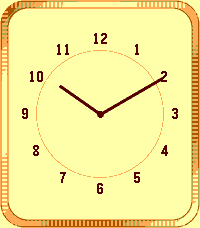

# Analog Studio

A configurable analog watchface for Pebble. Start with one of three
constructions, Ivory, Frost or Noir, then choose the bezel, dial, hands,
markings, date, seconds and contrast. The watch draws the hands and markings
over the materials you pick.

It is listed on the Pebble Appstore as Analog Studio. Inside the package it is
still called Classic Studio (`classic-studio`), so search for either name.

[](https://apps.repebble.com/8e2e3c5a1eed4c9da3c5b424) [](LICENSE) [](https://ambient-time.com/watch/pebble/)



## Supported watches

| Watch | SDK target | Display |
| --- | --- | --- |
| Pebble Time 2 | Emery | 200 × 228, color |
| Pebble 2 / 2 SE | Diorite | 144 × 168, monochrome |
| Pebble Time Round | Chalk | 180 × 180, color |
| Pebble Round 2 | Gabbro | 260 × 260, color |

All four share version 0.3.0 and one app identity. The package name stays
`classic-studio` so that installed copies keep their settings.

## Choose a design

Open the settings gear in the Pebble phone app. The bundled form offers all
settings without requiring a hosted configuration page. It also links to an
optional online visual editor.

There are six bezel finishes (Brass, Cool Chrome, Noir, Warm Copper, Blued
Steel and Verdigris) and six dial finishes (Ivory, Frost, Ink Black,
Verdigris, Ocean and Rosewood). Monochrome watches use purpose-built linework;
color finishes share the corresponding light or dark treatment there.

The watch saves an accepted design and restores it after a restart. Invalid
settings leave the previous design intact. Seconds are off by default;
enabling them changes drawing from once per minute to once per second.

This face supports three constructions and 7,776 combinations. It is based
on my web [Watch Face Lab](https://datapoems.io/clocks/bases/faces.html),
which has many more designs; the watch does not render arbitrary browser
designs. The online editor previews the materials and layout, but its fonts
and colors differ a little from the watch's system fonts and limited palette.

## Build

Install Pebble Tool 5.0.x and Pebble SDK 4.33.1, then run:

```sh
pebble build --sdk 4.33.1
```

The resulting `build/<checkout-directory-name>.pbw` includes all four targets
(for example, `build/pebble-analog-studio.pbw`). Open it with
the Pebble phone app to install it. The included artwork is enough to build;
asset generation is optional. No npm dependencies are required for this build.

## Test

Host checks require Node.js 22 or later, a C compiler, and ImageMagick 7
(`magick` on PATH, or set `MAGICK` to its executable path).

```sh
node --test test/settings.test.js test/artwork.test.mjs
node tools/generate-assets.mjs --check
mkdir -p build
cc -std=c11 -Wall -Wextra -Werror -fsanitize=address,undefined \
  test/settings_host.c -o build/settings-host
build/settings-host
```

These checks cover all 7,776 settings codes, malformed input, phone-cache
behavior, platform routing, artwork dimensions and hashes, and compatibility
with the original artwork IDs. The Round 2 test reconstructs all 108 color
references from the three bundled tone masks and native palettes.

For native emulator checks, run this with the Python interpreter that owns
Pebble Tool:

```sh
python test/emulator_smoke.py emery
```

Repeat for `diorite`, `chalk`, and `gabbro`. The harness uses its own persistent
profile under `build/emulator-state/` and records the PBW hash in
`build/evidence/`. It sends settings through AppMessage, checks invalid-input
rejection and restart retention, and captures second-hand movement.
`node test/stage-assets.mjs` checks all four reports against the current PBW
before copying media into `build/store-assets/`.

The included `evidence/` images and reports are historical emulator evidence
for the published 0.3.0 binary, SHA-256
`e604aa4557bd9f35e4516e02ee9b914f3471a50360075f922bd10d78e0fa88c9`.
A fresh build needs its own emulator evidence.

## Artwork source

`tools/generate-assets.mjs` draws the materials from the bundled palette snapshot
and recipe contract. It produces only the four Pebble targets. To regenerate,
install the optional `sharp` Node package and ImageMagick 7, then run:

```sh
npm install --no-save --package-lock=false sharp@0.34.5
node tools/generate-assets.mjs
node --test test/artwork.test.mjs
```

Image-library versions can affect PNG bytes. Regeneration updates the asset
manifest; inspect resulting images and rerun the native checks before shipping.
The source-release checks verify the included artwork; they do not establish
byte-identical regeneration with every image-library version.

Round 2 bundles three small tone masks, recolored by the native renderer.
Its 108 full-color PNGs are reference images. The other watches use their
platform-specific resources. No external font files or photographic textures
are needed. See [source and licensing notes](SOURCE.md).

## Settings format

`L1:recipe:bezel:dial:hands:marks:date:seconds:contrast`

Recipe is 1–3; bezel and dial are 1–6; hands and marks are 0–2, with 0 following
the recipe; date, seconds, and contrast are 0 or 1. Every field is one digit.
The native renderer and phone bridge reject unknown versions, missing or extra
fields, whitespace, and values outside those ranges. Version and setting IDs
are stable: extensions must preserve existing saved codes.

## License

Copyright 2026 Luke Steuber. Code, procedural artwork, and palette adaptations
are available under the [MIT License](LICENSE). Pebble SDK and optional build
tools retain their own licenses.

## Related

- [Web analog bases](https://datapoems.io/clocks/bases/faces.html)
- [Pebble collection](https://ambient-time.com/watch/pebble/)
